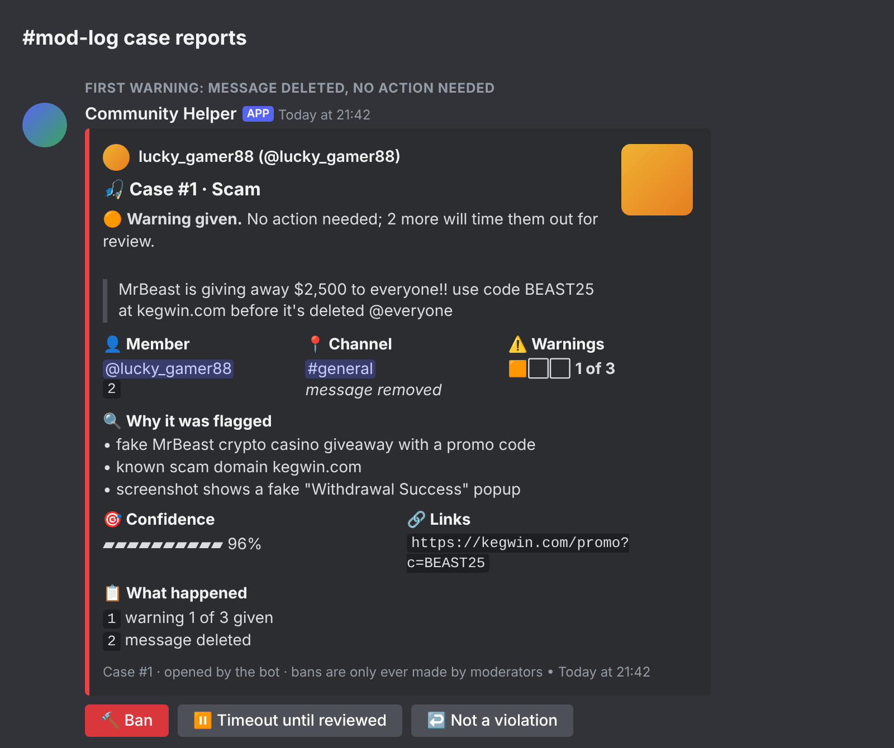

> [!IMPORTANT]
> This bot never shares, hosts or helps find game files. Its anti-piracy filter removes them on sight.
> Every recompilation project expects you to dump the games you own yourself.

<h1 align="center">
  Static Recomp AI Bot for Discord<br>
  <a href="https://github.com/BearddOddity/Static-Recomp-AI-discord-Bot/releases">
    
  </a>
  <a href="https://github.com/BearddOddity/Static-Recomp-AI-discord-Bot/actions/workflows/tests.yml">
    
  </a>
  
  
  <a href="LICENSE">
    
  </a>
</h1>

Static Recomp AI is an open source Discord bot for the static recompilation community: an AI assistant and a moderator in one. As an assistant, it has a personality inspired by Tony Stark's J.A.R.V.I.S. It answers anything members ask, and it uses the docs of [xboxrecomp](https://github.com/sp00nznet/xboxrecomp), [ps3recomp](https://github.com/sp00nznet/ps3recomp) and [ReXGlue](https://github.com/rexglue/rexglue-sdk) as its reference. As a moderator, it catches scams (including scams made only of screenshots), piracy and hate speech. It warns members first and leaves every ban to a human. It runs on free AI models with nothing to host, on Claude, or on a model on your own machine.

> [!IMPORTANT]
> This is an **alpha**. It hasn't been tested on a busy live server yet. Please report anything odd as a [GitHub issue](https://github.com/BearddOddity/Static-Recomp-AI-discord-Bot/issues).

## Table of Contents

- [Requirements](#requirements)
- [How to Install](#how-to-install)
- [Features](#features)
- [Commands](#commands)
- [Configuration](#configuration)
- [Use It as a Template](#use-it-as-a-template)
- [Development](#development)
- [Notes](#notes)
- [Credits](#credits)
- [License](#license)

## Requirements

- A Discord server where you have **admin** rights
- Somewhere to run it. It doesn't have to be your PC:
  - a **free cloud server** ([how](docs/HOSTING.md)), a Raspberry Pi, or any machine with **Python 3.10+** and **Git**
  - or anything that runs **Docker**
- An AI model, any one of these:
  - **OpenRouter**, Groq or Gemini: free tiers, nothing to host
  - **Claude**: paid, and the best at reading screenshots
  - **Ollama** or a command-line AI tool: runs on your own hardware

No AI runs on that machine unless you choose Ollama, so the smallest free cloud server is plenty.

## How to Install

The full step-by-step walkthrough is in **[SETUP.md](SETUP.md)**. It takes about 20 minutes and no programming.

1) Create the bot in the [Discord Developer Portal](https://discord.com/developers/applications) and turn on **Message Content Intent**.

2) Invite it with the link in [SETUP.md](SETUP.md#2-invite-the-bot-to-your-server). The link grants exactly the permissions the bot needs and nothing more.

3) Download the bot with `git clone https://github.com/BearddOddity/Static-Recomp-AI-discord-Bot`, so it can update itself. (The [release ZIP](https://github.com/BearddOddity/Static-Recomp-AI-discord-Bot/releases) works too, without self-updates.)

4) Copy `.env.example` to `.env` and fill in your bot token, your AI key and your `#mod-log` channel ID. For the Static Recomp server, also add:

    ```
    SERVER_PROFILE=servers/static-recomp/server.env
    ```

5) Start it, and keep it running without you:
    - **Linux server / Raspberry Pi:** run `./deploy/install-linux.sh` (starts at boot)
    - **Docker:** run `docker compose up -d` (starts at boot)
    - **Windows:** run `deploy\install-windows.bat` (starts when you sign in), or just double-click `start.bat`
    - **macOS:** run `./start.sh`

6) In Discord, run **`/status`**. It checks every setting and permission and tells you what to fix.

> [!TIP]
> No AI key yet? A free [OpenRouter](https://openrouter.ai/keys) key is all you need. Leave the model empty and the bot picks free models by itself, including one that can read screenshots for moderation.

## Features

### AI Assistant

Ask it anything: your build fails, which controller works best, what an error means, or just how its day is going. It answers first, then offers the one thing you'll probably need next, with a dry wit and no fuss.

- **Three ways to ask:** `/ask`, an **@mention**, or a **reply** to one of its answers to follow up. It remembers the last few exchanges.
- **Assistant channels:** give it channels where it answers every message, like a chat window.
- **Knows the room:** who's asking, which channel, today's date and the last few messages, so "what do you think of Sam's idea?" makes sense.
- **Reads screenshots:** attach an error dialog or a crash and ask about it.
- **Honest:** it says when it's unsure, follows your `#rules`, and never helps find game files.

### Stays Online by Itself

Feature|What it does
-|-
Runs without your PC|Install it once on a free cloud server; it starts at boot and restarts after crashes ([guide](docs/HOSTING.md))
Self-updating|Every 30 minutes it pulls new commits from GitHub and restarts with them
Free-model fallback|If an OpenRouter model is busy or removed, it switches to another free model and keeps answering
Asks for help on GitHub|A removed model becomes a **pull request** that swaps in a working one. A dead key becomes an **issue**, because keys never go in git. Both are posted in `#mod-log`

### Docs Search

The bot downloads the GitHub docs and wikis you choose and cites them under its answers.

Feature|What it does
-|-
Keyword routing|"Xbox" → xboxrecomp, "360" → ReXGlue, "PS3" → ps3recomp, so a PS3 question never gets Xbox instructions
Section context|Each section knows the headings above it, such as *Installing › Linux*
Forgiving matching|Word forms, common synonyms ("setup" and "install") and small typos all match
AI rephrasing|When a question uses different words from the docs, the AI rewrites it into the docs' wording and searches again
Code-safe|Code blocks are never cut in half
Always loads|If GitHub's free hourly limit runs out, it downloads the repos with `git` instead

More in [docs/ASSISTANT.md](docs/ASSISTANT.md).

### Moderation

Free speech is the policy here: opinions, criticism, rudeness and profanity are never moderated. The bot steps in for these:

Catches|How
-|-
**Scams**|Known scam sites, lookalike domains (`dlscord-gift.com`), crypto-giveaway phrasing, cross-posting raids, and an AI that reads screenshot-only scams such as fake MrBeast casino posts
**Piracy**|Game files of any kind (`.iso`, `.xex`, `.xbe`, `.elf`, ROMs, disc images, packages, keys), including inside `.zip` files, plus piracy sites and direct download links
**Hate speech**|Discord AutoMod's Slurs filter and the AI. Profanity never counts
**Rule breaks**|Whatever your `#rules` channel says, re-read whenever it changes

YouTube, GitHub, GIFs and wikis (Fandom included) are always welcome, and so are most other links.

### Warning Ladder

Step|What happens
-|-
**1st and 2nd warning**|The message is deleted, the member gets a DM, and moderators get a case report
**3rd warning**|The member is timed out, and the case is handed to a human
**Hate speech**|Straight to a timeout and a human review
**Ban**|Only a moderator can ban, with a button and a confirm step. The bot never bans

### Case Reports

Each case is a colour-coded card in your `#mod-log` channel. It shows a status line that says whether anyone needs to act, the quoted message, a warning meter, the reasons and the AI's confidence. Images are attached as spoilered evidence. The buttons let a moderator **Ban**, **Lift the timeout** or mark the case **Not a violation**.

<p align="center">
  
</p>

More in [docs/MODERATION.md](docs/MODERATION.md), including [every case state](docs/case-reports.png).

## Commands

Command|Who|What it does
-|-|-
`/ask`|Everyone|Ask the assistant anything
`@bot …`|Everyone|Same as `/ask`; reply to its answer to follow up
`/warn`|Moderators|Warn a member by hand (it counts toward the 3)
`/warnings`|Moderators|A member's warnings and recent cases
`/status`|Admins|Check the bot's setup, permissions and AI
`/reload-docs`|Admins|Download the GitHub docs again

## Configuration

Every setting lives in `.env`, and [`.env.example`](.env.example) explains each one. The ones most people change:

Setting|Default|What it does
-|-|-
`AI_PROVIDER`|`openrouter`|Which AI to use ([all providers](docs/AI-PROVIDERS.md))
`OPENAI_COMPAT_MODEL`|*(free pick)*|Model for answers. Comma-separate backups
`MOD_AI_MODEL`|*(free pick)*|A separate image-capable model for moderation
`HEALTH_GITHUB_TOKEN`||Lets the bot open pull requests and issues when the AI needs attention ([how](docs/HOSTING.md#ai-health))
`AUTO_UPDATE`|`true`|Pull updates from GitHub and restart
`MOD_LOG_CHANNEL_ID`||Where case reports go
`ASSISTANT_CHANNEL_IDS`||Channels where the bot answers every message
`MOD_WARN_LIMIT`|`3`|The warning that times a member out
`MOD_ACTION`|`delete`|`flag` leaves messages up for a moderator to judge
`MOD_AI_SCAN`|`suspicious`|`all` checks every message against your rules, for one AI call each
`DOCS_AI_QUERY`|`fallback`|When the AI rephrases questions before searching the docs

## Use It as a Template

The code in `bot/` contains nothing specific to any one server. A community's topic, docs repos and keywords live in a **server profile**, so you can build your own bot from this one:

1) Click **Use this template** or **Fork**, or download the ZIP.
2) Delete `servers/static-recomp/`.
3) Set `COMMUNITY_ABOUT`, `DOCS_REPOS` and `DOCS_ROUTES` in `.env`, or write your own `servers/<name>/server.env`.

## Development

[Running from source, tests and the code layout are here](docs/DEVELOPMENT.md). AI coding assistants should read [AGENTS.md](AGENTS.md) first: it covers the rules the bot must keep, such as no automatic bans and free speech.

## Notes

Static Recomp AI was built for a community of people who reverse-engineer and recompile console games, so it takes piracy seriously and treats its members' time with respect. A false alarm costs a real member, so detection is cautious: every warning can be undone with one click, and every ban is a human's call.

Cases and warnings stay in a local SQLite file on your machine. Messages go to your AI provider only when someone asks the bot something, or when a message looks risky enough to need a second look (or every message, if you set `MOD_AI_SCAN=all`).

## Credits

### Docs the assistant learns from
* **[xboxrecomp](https://github.com/sp00nznet/xboxrecomp)** and **[ps3recomp](https://github.com/sp00nznet/ps3recomp)** by sp00nznet
* **[ReXGlue SDK](https://github.com/rexglue/rexglue-sdk)** and [its wiki](https://github.com/rexglue/rexglue-sdk/wiki), the toolchain behind many Xbox 360 recompilations

### Built with
* **[discord.py](https://github.com/Rapptz/discord.py)**: the Discord library
* **[httpx](https://github.com/encode/httpx)** and **[python-dotenv](https://github.com/theskumar/python-dotenv)**
* **[OpenRouter](https://openrouter.ai)**, **[Anthropic](https://www.anthropic.com)**, **[Ollama](https://ollama.com)** and every provider that keeps free and open models available

### Inspiration
* **J.A.R.V.I.S.** from Marvel's *Iron Man*, for the assistant's manners. This is a fan nod; the project isn't affiliated with Marvel.

## License

MIT. See [LICENSE](LICENSE). Use it, change it and build on it.
